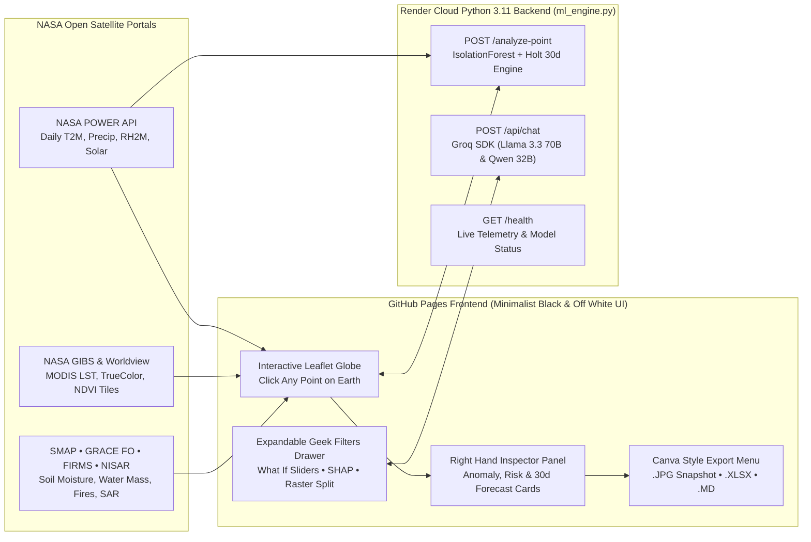
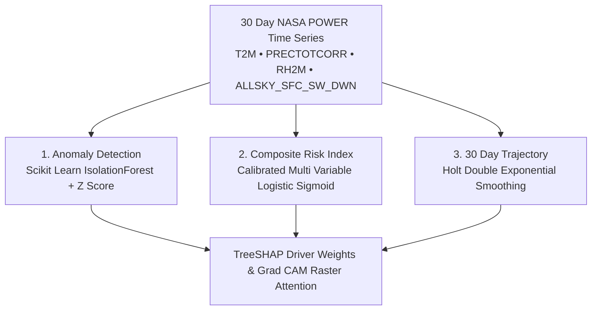

# AETHRA

&lt;div align=&quot;center&quot;&gt;

&lt;img src=&quot;https://capsule-render.vercel.app/api?type=waving&amp;color=0:000000,50:0a0a0a,100:18181b&amp;height=220&amp;section=header&amp;text=AETHRA&amp;fontSize=76&amp;fontColor=ffffff&amp;animation=fadeIn&amp;fontAlignY=38&amp;desc=Earth%20Observation%20%26%20Predictive%20Environmental%20Intelligence&amp;descAlignY=62&amp;descSize=18&amp;descColor=a1a1aa&quot; width=&quot;100%&quot; alt=&quot;AETHRA Header Banner&quot; /&gt;

&lt;a href=&quot;https://www.google.com/search?q=https://pranshusharma21.github.io/AETHRA/&quot;&gt;
  &lt;img src=&quot;https://readme-typing-svg.demolab.com?font=JetBrains+Mono&amp;weight=600&amp;size=18&amp;duration=3200&amp;pause=900&amp;color=F8F9FA&amp;background=00000000&amp;center=true&amp;vCenter=true&amp;width=780&amp;lines=Multi+Sensor+NASA+Satellite+Fusion+Engine;Click+Any+Point+On+Earth+For+Live+Telemetry;Isolation+Forest+Anomalies+%2B+Logistic+Risk+Scoring;30+Day+Holt+Exponential+Smoothing+Forecasts;Powered+By+FastAPI+%2B+Scikit+Learn+%2B+Groq+LLM&quot; alt=&quot;Typing Animation&quot; /&gt;
&lt;/a&gt;

<br/>

[Live Web Platform](https://www.google.com/search?q=https://pranshusharma21.github.io/AETHRA/)
[Geospatial Console](https://www.google.com/search?q=https://pranshusharma21.github.io/AETHRA/dashboard.html)
[Cloud ML Engine](https://www.google.com/search?q=https://aethra-ml-backend.onrender.com/health)
[](https://www.earthdata.nasa.gov/)

<br/>


&lt;/div&gt;

## Overview

**AETHRA** is an AI powered Earth observation and environmental intelligence platform developed by a five member engineering team from **Vivekananda Institute of Professional Studies (VIPS)** for the [NASA Space Apps Challenge](https://www.spaceappschallenge.org/).

Satellites collect massive daily measurements of surface heat, rainfall, root zone soil moisture, vegetation greenness, and underground water mass through [NASA Earthdata](https://www.earthdata.nasa.gov/). However, traditional monitoring tools typically examine a single variable in isolation. **AETHRA** connects eight satellite datasets into a minimalist pitch black and off white web interface paired with a live Python machine learning microservice hosted on Render. Users can click any coordinate on Earth to fetch real daily satellite records and inspect three separate scientific outputs:

1. **Observed Statistical Anomaly ($\sigma$)**: Measures how unusual current surface conditions are compared to a thirty year baseline using [Scikit Learn](https://scikit-learn.org/stable/getting_started.html) `IsolationForest` and standard deviation scoring.
2. **Estimated Environmental Risk Score (`0` to `100`)**: Combines thermal stress, soil moisture deficit, gravimetric water loss, and active fire detections through a calibrated multi variable logistic fusion model.
3. **Thirty Day Temperature Forecast ($\Delta^\circ\text{C}$)**: Projects short term surface temperature trajectories using Holt double exponential smoothing autoregression over live [NASA POWER](https://power.larc.nasa.gov/) time series.

## Interactive System Architecture



## Core Platform Capabilities

&lt;details open&gt;
&lt;summary&gt;&lt;b&gt;1. Click Any Coordinate on Earth (Live Satellite Point Retrieval)&lt;/b&gt;&lt;/summary&gt;
<br/>

Clicking anywhere on the central [Leaflet](https://leafletjs.com/) satellite globe drops an interactive target marker, reverse geocodes the place name, and queries a thirty day window of daily observations (`T2M` surface temperature, `PRECTOTCORR` precipitation, `RH2M` relative humidity, and `ALLSKY_SFC_SW_DWN` solar flux) from the live [NASA POWER API](https://power.larc.nasa.gov/) alongside our Render Python `/analyze-point` microservice.

&lt;/details&gt;

&lt;details&gt;
&lt;summary&gt;&lt;b&gt;2. Multi Layer NASA GIBS Satellite Tile Switcher&lt;/b&gt;&lt;/summary&gt;
<br/>

Switch seamlessly across four real time satellite raster layers streamed from [NASA Worldview](https://worldview.earthdata.nasa.gov/) and the [NASA GIBS API](https://www.earthdata.nasa.gov/engage/open-data-services-software/earthdata-developer-portal/gibs-api) over [Esri World Imagery](https://www.arcgis.com/home/item.html?id=10df2279f9684e4a9f6a7f08febac2a9):
* **Surface Temp**: `MODIS_Terra_Land_Surface_Temp_Day` thermal anomaly layer.
* **True Color**: `MODIS_Terra_CorrectedReflectance_TrueColor` daily optical imagery.
* **Vegetation**: `MODIS_Terra_NDVI_8Day` canopy vigor index.
* **Base Map**: High resolution satellite imagery with hotspot pins.

&lt;/details&gt;

&lt;details&gt;
&lt;summary&gt;&lt;b&gt;3. Collapsible &quot;Advanced Filters&quot; Drawer for Researchers &amp; Geeks&lt;/b&gt;&lt;/summary&gt;
<br/>

To keep the main dashboard clean and human friendly, complex scientific tools are tucked inside the **Advanced Filters ▾** drawer, which smoothly auto pans into view when opened:
* **Four Parameter What If Scenario Simulator**: Perturb Temperature ($\Delta\text{LST}$ from `-2.0°C` to `+5.0°C`), Precipitation (`-60%` to `+60%`), Soil Moisture (`-50%` to `+50%`), and Vegetation (`-40%` to `+30%`) to watch risk scores and SHAP weights update live.
* **Historical Trend & Thirty Day Projection Chart**: Plots 2020 through 2026 observations against the thirty year baseline and the thirty day Holt forecast using [Chart.js](https://www.chartjs.org/).
* **Model Driver Weights (SHAP Attribution)**: Displays exact percentage contributions of Surface Temperature, Soil Moisture, Canopy Vegetation, Groundwater Storage, and Active Fires.
* **Before and After Satellite Raster Split Canvas**: Interactive split slider comparing 2020 baseline terrain against 2026 observed conditions with a toggleable AI attention heatmap overlay.
* **Ask AETHRA AI Assistant**: Powered by the official [GroqCloud](https://console.groq.com/) Python SDK (`llama-3.3-70b-versatile` and `qwen/qwen3-32b`) on Render plus an in browser multi station comparative ranking engine.

&lt;/details&gt;

&lt;details&gt;
&lt;summary&gt;&lt;b&gt;4. Canva Style Multi Format Export Menu (.JPG, .XLSX, .MD)&lt;/b&gt;&lt;/summary&gt;
<br/>

Located in the top right corner of the dashboard toolbar, the **Export ▾** menu generates three instant deliverables for any selected hotspot or custom clicked coordinate:
* **Area Snapshot Image (`.JPG`)**: High resolution `1200x675` visual summary card rendered on HTML5 Canvas with target map preview, coordinates, anomaly/risk/forecast callouts, sensor bar, and plain English summary.
* **Telemetry Spreadsheet (`.XLSX`)**: Multi sheet Excel workbook (`Area Summary` and `Historical Trends`) generated client side via SheetJS.
* **Structured Briefing (`.MD`)**: Clean Markdown environmental report citing all active NASA data feeds.

&lt;/details&gt;

## Global Benchmark Hotspots & Telemetry Matrix

| Station / Region | Coordinates | Primary Environmental Hazard | Observed Anomaly | Composite Risk Score | 30 Day Temp Shift | Surface Temp | Soil Moisture | GRACE Water Storage | Active Fires |
| :--- | :--- | :--- | :--- | :--- | :--- | :--- | :--- | :--- | :--- |
| **[Manaus, Brazil](https://latitudelongitude.org/br/manaus/)** | `-3.1019°, -60.0250°` | Canopy Moisture Stress & Active Fires | `+3.12σ` | **`91.2 / 100`** | `+1.78°C` | `34.9°C` | `24.5%` | `-19.2 cm` | `486` |
| **[Svalbard, Norway](https://latitudelongitude.org/sj/longyearbyen/)** | `78.2233°, 15.6469°` | Polar Warming, Ice Loss & Permafrost Thaw | **`+3.45σ`** | `88.7 / 100` | **`+2.15°C`** | `4.8°C` | `41.0%` | **`-26.5 cm`** | `4` |
| **[New Delhi, India](https://latitudelongitude.org/in/new-delhi/)** | `28.6358°, 77.2245°` | Groundwater Depletion & Thermal Stress | `+2.84σ` | `86.4 / 100` | `+1.45°C` | **`36.8°C`** | `18.2%` | `-14.8 cm` | `142` |
| **[Nairobi, Kenya](https://latitudelongitude.org/ke/nairobi/)** | `-1.2833°, 36.8167°` | Rainfall Deficit & Rangeland Decline | `+2.68σ` | `82.1 / 100` | `+1.34°C` | `31.2°C` | `16.7%` | `-11.6 cm` | `118` |
| **[Central Valley, USA](https://latitudelongitude.org/us/fresno/)** | `36.7477°, -119.7724°` | Aquifer Subsidence & Crop Stress | `+2.41σ` | `79.5 / 100` | `+1.22°C` | `33.4°C` | **`15.9%`** | `-22.4 cm` | `94` |

## Mathematical & Machine Learning Formulation



1. **Isolation Forest & Empirical Z Score Anomaly**:
   $$Z_{\text{obs}} = \text{clip}\left(\frac{|T_{\text{latest}} - \mu_T|}{\sigma_T} + 1.2 \cdot s_{\text{iso}}(T_{\text{latest}}),\; 0.25,\; 4.20\right)$$
2. **Multi Variable Logistic Risk Fusion (`0` to `100`)**:
   $$\text{Risk} = \frac{100}{1 + \exp\big(-(-1.1 + 0.55 Z_{\text{obs}} + 0.04 \max(0, 30 - M_{\text{soil}}) + 0.03 \max(0, T_{\text{latest}} - 25))\big)}$$
3. **Holt Linear Exponential Smoothing (30 Day Projection)**:
   $$\ell_t = \alpha y_t + (1 - \alpha)(\ell_{t-1} + b_{t-1}), \qquad b_t = \beta(\ell_t - \ell_{t-1}) + (1 - \beta)b_{t-1}, \qquad \hat{\Delta}_{30\text{d}} = h \cdot b_t$$

## NASA Missions & Open Data Portals Integrated

| Mission / Portal | Parameters Retrieved | Official Resource URL |
| :--- | :--- | :--- |
| **NASA Earthdata Portal** | Multi sensor Earth observation collections and catalog | [https://www.earthdata.nasa.gov/](https://www.earthdata.nasa.gov/) |
| **NASA POWER Project API** | Live daily solar irradiance, `T2M` temperature, humidity, and rainfall | [https://power.larc.nasa.gov/](https://power.larc.nasa.gov/) |
| **NASA Worldview & GIBS** | Daily satellite WMTS raster tiles for LST, True Color, and NDVI | [https://worldview.earthdata.nasa.gov/](https://worldview.earthdata.nasa.gov/) |
| **NASA GIBS Developer API** | OGC Web Map Tile Service endpoints (`EPSG:3857`) | [https://www.earthdata.nasa.gov/engage/open-data-services-software/earthdata-developer-portal/gibs-api](https://www.earthdata.nasa.gov/engage/open-data-services-software/earthdata-developer-portal/gibs-api) |
| **NASA FIRMS (MODIS & VIIRS)** | Near real time active fire hotspots (`375m` and `1km`) | [https://firms.modaps.eosdis.nasa.gov/](https://firms.modaps.eosdis.nasa.gov/) |
| **NASA SMAP Mission** | Surface and root zone soil moisture percentage | [https://www.earthdata.nasa.gov/data/platforms/space-based-platforms/smap](https://www.earthdata.nasa.gov/data/platforms/space-based-platforms/smap) |
| **NASA GRACE & GRACE FO** | Gravimetric terrestrial water storage and cryospheric mass anomalies | [https://gracefo.jpl.nasa.gov/data/grace-fo-data/](https://gracefo.jpl.nasa.gov/data/grace-fo-data/) |
| **NASA MODIS & Landsat** | Land surface temperature and canopy spectral reflectance | [https://science.nasa.gov/mission/landsat/](https://science.nasa.gov/mission/landsat/) |
| **NASA ISRO NISAR & ASF DAAC** | Dual band Synthetic Aperture Radar ground deformation and subsidence | [https://www.earthdata.nasa.gov/data/platforms/space-based-platforms/nisar](https://www.earthdata.nasa.gov/data/platforms/space-based-platforms/nisar) |

## Repository Structure (Root Level Architecture)

| File Name | Role in AETHRA | Hosting Target |
| :--- | :--- | :--- |
| `index.html` | Minimalist black and off white Home page with orbital Earth hero, plain English overview, and station chart | GitHub Pages |
| `dashboard.html` | Main interactive satellite map console, Recommended Hotspots bar, right hand inspector, and Geek Filters drawer | GitHub Pages |
| `source.html` | Dedicated directory of all integrated NASA satellite missions and open data portals | GitHub Pages |
| `about.html` | Self contained VIPS team showcase with cursor tracking spotlight cards and LinkedIn links | GitHub Pages |
| `contact.html` | Standalone feedback and regional coordinate request page | GitHub Pages |
| `dashboard.css` | Minimalist pitch black (`#000000`) and off white (`#f8f9fa`) stylesheet with smooth button underline animations | GitHub Pages |
| `dashboard.js` | Frontend state engine, live NASA POWER point fetcher, Holt 30d forecaster, and `.JPG`/`.XLSX`/`.MD` exporters | GitHub Pages |
| `ml_engine.py` | Unified Python [FastAPI](https://fastapi.tiangolo.com/) service running `IsolationForest`, Holt 30d forecasting, and [GroqCloud](https://console.groq.com/) LLM chat | Render Cloud |
| `requirements.txt` | Python package dependencies (`fastapi`, `uvicorn`, `numpy`, `pydantic`, `scikit-learn`, `groq`) | Render Cloud |
| `runtime.txt` | Pins `python-3.11.10` on Render for fast prebuilt wheel installation | Render Cloud |

## Cloud API Endpoints (`https://aethra-ml-backend.onrender.com`)

&lt;details&gt;
&lt;summary&gt;&lt;b&gt;GET &lt;code&gt;/health&lt;/code&gt; — Service &amp; Model Health Check&lt;/b&gt;&lt;/summary&gt;
<br/>

```json
{
  "status": "online",
  "project": "AETHRA",
  "team": "Verdant Void",
  "groq_configured": true,
  "models": [
    "IsolationForest",
    "LogisticRiskFusion",
    "HoltLinear30d",
    "Groq-SDK"
  ]
}
```

&lt;/details&gt;

&lt;details&gt;
&lt;summary&gt;&lt;b&gt;POST &lt;code&gt;/analyze-point&lt;/code&gt; — Live Coordinate NASA POWER + IsolationForest Inference&lt;/b&gt;&lt;/summary&gt;
<br/>

**Request Body:**
```json
{
  "lat": 28.6358,
  "lon": 77.2245
}
```

**Response Body:**
```json
{
  "coordinates": { "lat": 28.6358, "lon": 77.2245 },
  "observed_anomaly_z": 2.84,
  "estimated_risk_score": 86.4,
  "forecast_30d_temp_delta_c": 1.45,
  "latest_surface_temp_c": 36.8,
  "estimated_soil_moisture_pct": 18.2,
  "daily_precipitation_mm": 1.1,
  "ml_engine": "Scikit-Learn IsolationForest + Holt 30d"
}
```

&lt;/details&gt;

&lt;details&gt;
&lt;summary&gt;&lt;b&gt;POST &lt;code&gt;/api/chat&lt;/code&gt; — Grounded Groq / Qwen Multi Station Assistant&lt;/b&gt;&lt;/summary&gt;
<br/>

**Request Body:**
```json
{
  "query": "Which place is worst affected according to you?",
  "activeRegion": "New Delhi & Indo Gangetic Plain",
  "telemetryContext": "Manaus (Risk 91.2, Fires 486) | Svalbard (Anomaly +3.45sigma) | New Delhi (Risk 86.4)",
  "model": "llama-3.3-70b-versatile"
}
```

&lt;/details&gt;

## Quick Deployment Guide

1. **GitHub Pages (Frontend)**:
   * Upload `index.html`, `dashboard.html`, `source.html`, `about.html`, `contact.html`, `dashboard.css`, and `dashboard.js` to the root of your GitHub repository.
   * Navigate to **Settings → Pages**, select **Deploy from a branch (`main` / `/root`)**, and click **Save**.
2. **Render Web Service (Python ML & AI Backend)**:
   * Upload `ml_engine.py`, `requirements.txt`, and `runtime.txt` to the same repository.
   * Create a new **Python 3 Web Service** on Render connected to your repository.
   * Set **Build Command** to `pip install -r requirements.txt` and **Start Command** to `uvicorn ml_engine:app --host 0.0.0.0 --port $PORT`.
   * Add your `GROQ_API_KEY` under **Environment Variables** and deploy.

## Team AETHRA • Vivekananda Institute of Professional Studies (VIPS)

We are a team of five passionate technology enthusiasts from **Vivekananda Institute of Professional Studies (VIPS)**, driven by innovation and a shared interest in space technology, AI, and machine learning.

| Member | Role & Responsibility | Connect |
| :--- | :--- | :--- |
| **Pranshu Sharma** | Team Leader & Main System Developer (Cloud Architecture, FastAPI ML Pipeline & Deployment) | [](https://www.linkedin.com/in/pranshu-sharma-a52321334/) |
| **Pranav Verma** | UI / UX Design Lead (Minimalist Black & White Interface, Interactive Map UX & Presentation) | [](https://www.linkedin.com/in/pranav-verma-1aba0b430/) |
| **Karan Kohli** | Data Verification Lead (Multi Sensor NASA Dataset Calibration & Benchmark Verification) | [](https://www.linkedin.com/in/karan-kohli-2bbb4a283/) |
| **Aadya Jain** | Research & Fact Check Lead (Environmental Hazard Analysis & Scientific Source Attribution) | [](https://www.linkedin.com/in/aadya-jain-76443042a/) |
| **Aarti Kantoor** | Documentation & Optimization Lead (Workflow Optimization, Technical Docs & Deliverable QA) | [](https://www.linkedin.com/in/aarti-kantoor-620135431/) |

&lt;div align=&quot;center&quot;&gt;

&lt;img src=&quot;https://capsule-render.vercel.app/api?type=waving&amp;color=0:18181b,50:0a0a0a,100:000000&amp;height=110&amp;section=footer&quot; width=&quot;100%&quot; alt=&quot;AETHRA Footer Banner&quot; /&gt;

&lt;/div&gt;
