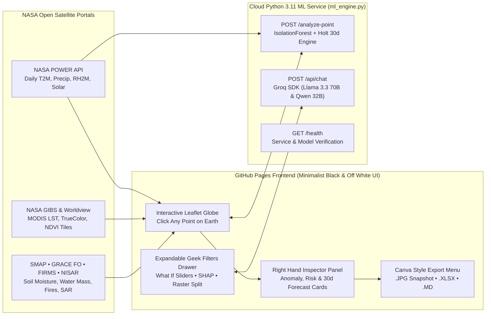
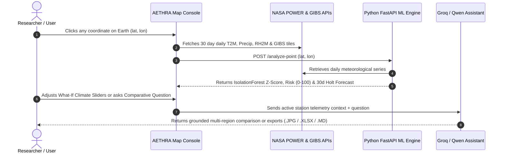
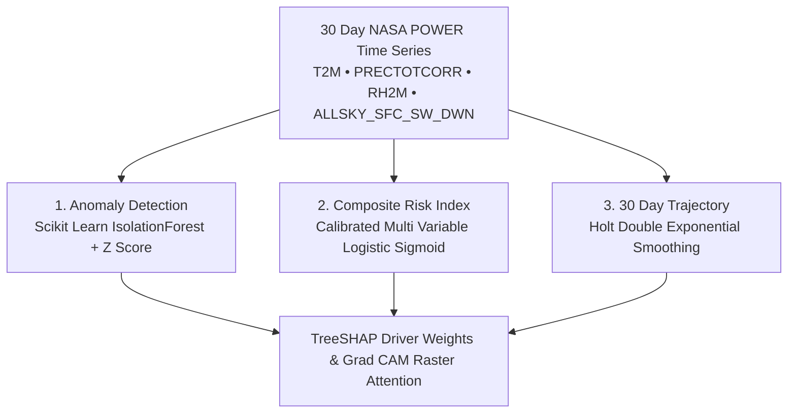

# AETHRA

**Quick Navigation:** [Live Web Platform ↗](https://www.google.com/search?q=https://pranshusharma21.github.io/AETHRA/) · [Interactive Map Dashboard ↗](https://www.google.com/search?q=https://pranshusharma21.github.io/AETHRA/dashboard.html) · [Data Sources Directory ↗](https://www.google.com/search?q=https://pranshusharma21.github.io/AETHRA/source.html) · [About Team AETHRA ↗](https://www.google.com/search?q=https://pranshusharma21.github.io/AETHRA/about.html)

## Overview

**AETHRA** is an AI powered Earth observation and environmental intelligence platform developed by a five member engineering team from **Vivekananda Institute of Professional Studies (VIPS)** for the [NASA Space Apps Challenge](https://www.spaceappschallenge.org/).

Satellites collect massive daily measurements of surface heat, rainfall, root zone soil moisture, vegetation greenness, and underground water mass through [NASA Earthdata](https://www.earthdata.nasa.gov/). However, traditional monitoring tools typically examine a single variable in isolation. **AETHRA** connects eight satellite datasets into a minimalist pitch black and off white web interface paired with a cloud Python machine learning microservice. Users can click any coordinate on Earth to fetch real daily satellite records and inspect three separate scientific outputs:

1. **Observed Statistical Anomaly ($\sigma$)**: Measures how unusual current surface conditions are compared to a thirty year baseline using [Scikit Learn](https://scikit-learn.org/stable/getting_started.html) `IsolationForest` and standard deviation scoring.
2. **Estimated Environmental Risk Score (`0` to `100`)**: Combines thermal stress, soil moisture deficit, gravimetric water loss, and active fire detections through a calibrated multi variable logistic fusion model.
3. **Thirty Day Temperature Forecast ($\Delta^\circ\text{C}$)**: Projects short term surface temperature trajectories using Holt double exponential smoothing autoregression over live [NASA POWER](https://power.larc.nasa.gov/) time series.

## Interactive System Architecture

## Interactive Telemetry & AI Workflow

## Core Platform Capabilities

* **Click Any Coordinate on Earth (Live Satellite Point Retrieval)**: Clicking anywhere on the central [Leaflet](https://leafletjs.com/) satellite globe drops an interactive target marker, reverse geocodes the place name, and queries a thirty day window of daily observations (`T2M` surface temperature, `PRECTOTCORR` precipitation, `RH2M` relative humidity, and `ALLSKY_SFC_SW_DWN` solar flux) from the live [NASA POWER API](https://power.larc.nasa.gov/) alongside our Python `/analyze-point` microservice.
* **Multi Layer NASA GIBS Satellite Tile Switcher**: Switch seamlessly across four real time satellite raster layers streamed from [NASA Worldview](https://worldview.earthdata.nasa.gov/) and the [NASA GIBS API](https://www.earthdata.nasa.gov/engage/open-data-services-software/earthdata-developer-portal/gibs-api) over [Esri World Imagery](https://www.arcgis.com/home/item.html?id=10df2279f9684e4a9f6a7f08febac2a9) (`MODIS_Terra_Land_Surface_Temp_Day`, `MODIS_Terra_CorrectedReflectance_TrueColor`, `MODIS_Terra_NDVI_8Day`, and high resolution Base Imagery).
* **Collapsible "Advanced Filters" Drawer for Researchers**: Keeps the main dashboard uncluttered while smoothly scrolling on click to reveal a four parameter What If climate simulator, a 2020 through 2026 historical trend and thirty day projection chart via [Chart.js](https://www.chartjs.org/), horizontal TreeSHAP feature importance bars, a before and after satellite raster split canvas, and the **Ask AETHRA AI Assistant** powered by [GroqCloud](https://console.groq.com/).
* **Canva Style Multi Format Export Menu (`.JPG`, `.XLSX`, `.MD`)**: Located in the top right corner of the dashboard toolbar, generating a `1200x675` visual area snapshot card (`.JPG`), a multi sheet Excel workbook (`.XLSX`), or a structured Markdown briefing (`.MD`).

## Global Benchmark Hotspots & Telemetry Matrix

| Station / Region | Coordinates | Anomaly | Risk Score | 30d Shift | Temp & Soil Moisture | Water Mass & Active Fires |
| :--- | :--- | :--- | :--- | :--- | :--- | :--- |
| **[Manaus, Brazil](https://latitudelongitude.org/br/manaus/)** | `-3.10°, -60.03°` | `+3.12σ` | **`91.2 / 100`** | `+1.78°C` | `34.9°C` · `24.5%` | `-19.2 cm` · **`486 fires`** |
| **[Svalbard, Norway](https://latitudelongitude.org/sj/longyearbyen/)** | `78.22°, 15.65°` | **`+3.45σ`** | `88.7 / 100` | **`+2.15°C`** | `4.8°C` · `41.0%` | **`-26.5 cm`** · `4 fires` |
| **[New Delhi, India](https://latitudelongitude.org/in/new-delhi/)** | `28.64°, 77.22°` | `+2.84σ` | `86.4 / 100` | `+1.45°C` | **`36.8°C`** · `18.2%` | `-14.8 cm` · `142 fires` |
| **[Nairobi, Kenya](https://latitudelongitude.org/ke/nairobi/)** | `-1.28°, 36.82°` | `+2.68σ` | `82.1 / 100` | `+1.34°C` | `31.2°C` · `16.7%` | `-11.6 cm` · `118 fires` |
| **[Central Valley, USA](https://latitudelongitude.org/us/fresno/)** | `36.75°, -119.77°` | `+2.41σ` | `79.5 / 100` | `+1.22°C` | `33.4°C` · **`15.9%`** | `-22.4 cm` · `94 fires` |

## Mathematical & Machine Learning Formulation

1. **Isolation Forest & Empirical Z Score Anomaly**:

$$Z_{\text{obs}} = \text{clip}\left(\frac{|T_{\text{latest}} - \mu_T|}{\sigma_T} + 1.2 \cdot s_{\text{iso}}(T_{\text{latest}}), 0.25, 4.20\right)$$

2. **Multi Variable Logistic Risk Fusion (`0` to `100`)**:

$$\text{Risk} = \frac{100}{1 + \exp\big(-(-1.1 + 0.55 Z_{\text{obs}} + 0.04 \max(0, 30 - M_{\text{soil}}) + 0.03 \max(0, T_{\text{latest}} - 25))\big)}$$

3. **Holt Linear Exponential Smoothing (30 Day Projection)**:

$$\ell_t = \alpha y_t + (1 - \alpha)(\ell_{t-1} + b_{t-1}), \qquad b_t = \beta(\ell_t - \ell_{t-1}) + (1 - \beta)b_{t-1}, \qquad \hat{\Delta}_{30\text{d}} = h \cdot b_t$$

## NASA Missions & Open Data Portals Integrated

| Mission / Portal | Parameters Retrieved | Official Resource URL |
| :--- | :--- | :--- |
| **NASA Earthdata Portal** | Multi sensor Earth observation collections and catalog | [https://www.earthdata.nasa.gov/](https://www.earthdata.nasa.gov/) |
| **NASA POWER Project API** | Live daily solar irradiance, `T2M` temperature, humidity, and rainfall | [https://power.larc.nasa.gov/](https://power.larc.nasa.gov/) |
| **NASA Worldview & GIBS** | Daily satellite WMTS raster tiles for LST, True Color, and NDVI | [https://worldview.earthdata.nasa.gov/](https://worldview.earthdata.nasa.gov/) |
| **NASA GIBS Developer API** | OGC Web Map Tile Service endpoints (`EPSG:3857`) | [https://www.earthdata.nasa.gov/engage/open-data-services-software/earthdata-developer-portal/gibs-api](https://www.earthdata.nasa.gov/engage/open-data-services-software/earthdata-developer-portal/gibs-api) |
| **NASA FIRMS (MODIS & VIIRS)** | Near real time active fire hotspots (`375m` and `1km`) | [https://firms.modaps.eosdis.nasa.gov/](https://firms.modaps.eosdis.nasa.gov/) |
| **NASA SMAP Mission** | Surface and root zone soil moisture percentage | [https://www.earthdata.nasa.gov/data/platforms/space-based-platforms/smap](https://www.earthdata.nasa.gov/data/platforms/space-based-platforms/smap) |
| **NASA GRACE & GRACE FO** | Gravimetric terrestrial water storage and cryospheric mass anomalies | [https://gracefo.jpl.nasa.gov/data/grace-fo-data/](https://gracefo.jpl.nasa.gov/data/grace-fo-data/) |
| **NASA MODIS & Landsat** | Land surface temperature and canopy spectral reflectance | [https://science.nasa.gov/mission/landsat/](https://science.nasa.gov/mission/landsat/) |
| **NASA ISRO NISAR & ASF DAAC** | Dual band Synthetic Aperture Radar ground deformation and subsidence | [https://www.earthdata.nasa.gov/data/platforms/space-based-platforms/nisar](https://www.earthdata.nasa.gov/data/platforms/space-based-platforms/nisar) |

## Repository Structure (Root Level Architecture)

| File Name | Role in AETHRA | Hosting Target |
| :--- | :--- | :--- |
| `index.html` | Minimalist black and off white Home page with orbital Earth hero, plain English overview, and station chart | GitHub Pages |
| `dashboard.html` | Main interactive satellite map console, Recommended Hotspots bar, right hand inspector, and Geek Filters drawer | GitHub Pages |
| `source.html` | Dedicated directory of all integrated NASA satellite missions and open data portals | GitHub Pages |
| `about.html` | Self contained VIPS team showcase with cursor tracking spotlight cards and LinkedIn links | GitHub Pages |
| `contact.html` | Standalone feedback and regional coordinate request page | GitHub Pages |
| `dashboard.css` | Minimalist pitch black (`#000000`) and off white (`#f8f9fa`) stylesheet with smooth button underline animations | GitHub Pages |
| `dashboard.js` | Frontend state engine, live NASA POWER point fetcher, Holt 30d forecaster, and `.JPG` / `.XLSX` / `.MD` exporters | GitHub Pages |
| `ml_engine.py` | Unified Python [FastAPI](https://fastapi.tiangolo.com/) service running `IsolationForest`, Holt 30d forecasting, and [GroqCloud](https://console.groq.com/) LLM chat | Render Cloud |
| `requirements.txt` | Python package dependencies (`fastapi`, `uvicorn`, `numpy`, `pydantic`, `scikit-learn`, `groq`) | Render Cloud |
| `runtime.txt` | Pins `python-3.11.10` on Render for fast prebuilt wheel installation | Render Cloud |

## Backend API Routes (`ml_engine.py`)

| Route | Method | Purpose | Output Fields |
| :--- | :--- | :--- | :--- |
| `/health` | `GET` | Verifies service uptime and model readiness | `status`, `project`, `models` |
| `/analyze-point` | `POST` | Runs `IsolationForest` and Holt 30d smoothing on live NASA POWER point series | `observed_anomaly_z`, `estimated_risk_score`, `forecast_30d_temp_delta_c` |
| `/api/chat` | `POST` | Executes grounded multi station reasoning via the official Groq Python SDK | `answer`, `model` |

## Team AETHRA • Vivekananda Institute of Professional Studies (VIPS)

We are a team of five passionate technology enthusiasts from **Vivekananda Institute of Professional Studies (VIPS)**, driven by innovation and a shared interest in space technology, AI, and machine learning.

| Member | Role & Responsibility | Connect |
| :--- | :--- | :--- |
| **Pranshu Sharma** | Team Leader & Main System Developer (Cloud Architecture, FastAPI ML Pipeline & Deployment) | [LinkedIn Profile ↗](https://www.linkedin.com/in/pranshu-sharma-a52321334/) |
| **Pranav Verma** | UI / UX Design Lead (Minimalist Black & White Interface, Interactive Map UX & Presentation) | [LinkedIn Profile ↗](https://www.linkedin.com/in/pranav-verma-1aba0b430/) |
| **Karan Kohli** | Data Verification Lead (Multi Sensor NASA Dataset Calibration & Benchmark Verification) | [LinkedIn Profile ↗](https://www.linkedin.com/in/karan-kohli-2bbb4a283/) |
| **Aadya Jain** | Research & Fact Check Lead (Environmental Hazard Analysis & Scientific Source Attribution) | [LinkedIn Profile ↗](https://www.linkedin.com/in/aadya-jain-76443042a/) |
| **Aarti Kantoor** | Documentation & Optimization Lead (Workflow Optimization, Technical Docs & Deliverable QA) | [LinkedIn Profile ↗](https://www.linkedin.com/in/aarti-kantoor-620135431/) |

